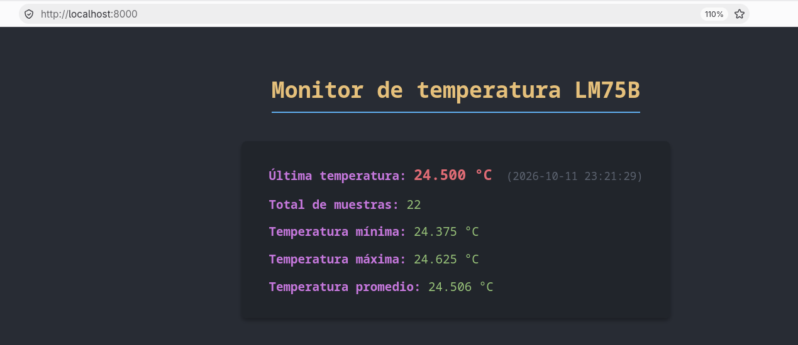
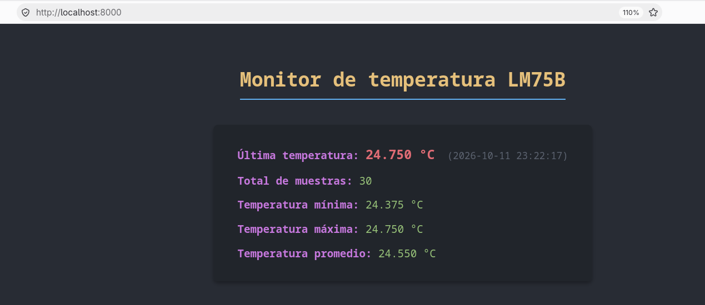
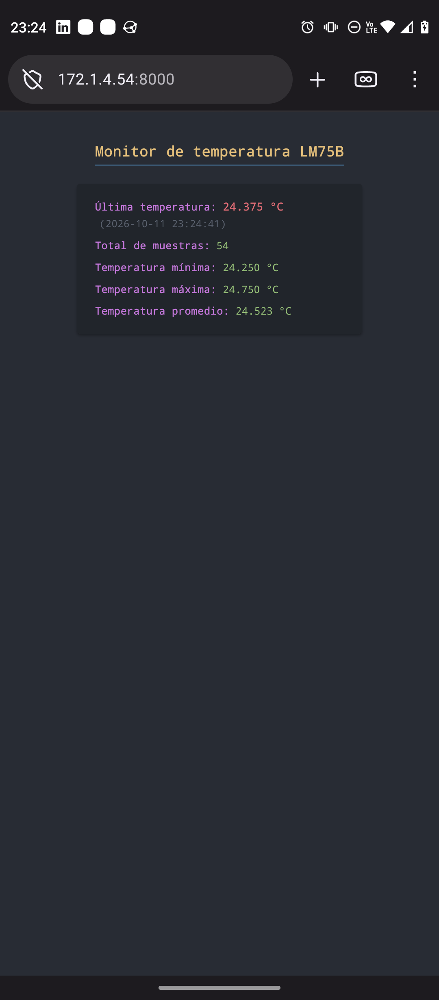

# Practica 03

## Objetivo

- Comprender el flujo de adquisición de datos en un sistema embebido a partir de un sensor físico.

- Implementar un programa capaz de realizar lecturas periódicas de un periférico utilizando el bus I2C.

- Desarrollar un sistema básico de registro de datos (data logger) que almacene información proveniente de un sensor.

- Utilizar el sistema de archivos de Linux para almacenar información generada por un sistema embebido.

- Implementar un servidor web sencillo capaz de leer los datos almacenados por el sistema de adquisición y desplegarlos a través de una interfaz accesible en red.

## Material

- Raspberry Pi 3 B.

- Fuente de alimentación para Raspberry Pi.

- Tarjeta microSD con sistema operativo instalado (Práctica 1)

- Cable Ethernet.

- Computadora configurada como servidor DHCP (Práctica 1)

- Módulo sensor de temperatura LM75B (Práctica 2)

- 1 Protoboard.

- Jumpers y/o cables.

## Actividad 1:  Registro periódico de temperatura con systemd

Implementar dos servicios de systemd

- Uno del tipo one shot que cada vez que ese inicia escribe la lectura del temperatura del sensor en un archivo .csv

- otro del tipo temporizador que periódicamente ejecuta el servicio anterior.

Temporizador → Servicio → Programa → Sensor LM75B y archivo CSV

#### 1.1 preparación del directorio

Clonamos el repositorio y preparamos la siguiente estructura

```shellsession
alumno@raspberrypi:~/practica03 $ tree
.
├── actividad_1
│   ├── lm75b_log.csv
│   ├── logger_lm75b
│   ├── logger_lm75b.c
│   └── Makefile
├── actividad_2
│   └── web_server.py
├── drivers
│   └── lm75b
│       ├── lm75b.c
│       └── lm75b.h
└── README.md

5 directories, 8 files
```

#### 1.2 Implementamos logger_lm75b.c

logger_lm75b.c

```c
#include <stdio.h>
#include <stdlib.h>
#include <time.h>
#include <string.h>
#include <errno.h>

// Inclusión del driver respetando la estructura de directorios
#include "../drivers/lm75b/lm75b.h"

int main() {
    // 1. Obtener una lectura del LM75B mediante el driver
    float temp_c = 0.0f;
    // Se asume el bus /dev/i2c-1 y la dirección 0x48 por defecto
    int rc = lm75b_read_temperature_c("/dev/i2c-1", 0x48, &temp_c);

    if (rc < 0) {
        fprintf(stderr, "Error al leer el sensor LM75B: %s\n", strerror(-rc));
        return 1;
    }

    // 2. Obtener la fecha y hora actuales como marca de tiempo Unix (segundos)
    time_t timestamp = time(NULL);

    // Construir la ruta absoluta ~/practica03/actividad_1/lm75b_log.csv
    char filepath[512];
    const char* home = getenv("HOME");
    if (!home) {
        fprintf(stderr, "Error: No se pudo obtener la variable de entorno HOME.\n");
        return 1;
    }
    snprintf(filepath, sizeof(filepath), "%s/practica03/actividad_1/lm75b_log.csv", home);

    // 3. Abrir el archivo en modo de adición y lectura ("a+")
    FILE *f = fopen(filepath, "a+");
    if (!f) {
        fprintf(stderr, "Error al abrir o crear el archivo %s: %s\n", filepath, strerror(errno));
        return 1;
    }

    // Comprobar el tamaño del archivo para saber si está vacío
    fseek(f, 0, SEEK_END);
    long size = ftell(f);
    fseek(f, 0, SEEK_SET); // Regresar al inicio para contar líneas si es necesario

    int lecture_num = 0;

    // 4. Escribir el encabezado únicamente si el archivo no existe o está vacío
    if (size == 0) {
        fprintf(f, "timestamp,lecture_num,temperature_c\n");
    } else {
        // Calcular el número de lectura contando las líneas existentes
        char buffer[256];
        int line_count = 0;
        while (fgets(buffer, sizeof(buffer), f)) {
            line_count++;
        }
        // Restar 1 para excluir el encabezado; el conteo inicia en 0
        lecture_num = (line_count > 0) ? line_count - 1 : 0;
    }

    // 5. Agregar una fila con la marca de tiempo, número de lectura y temperatura
    // Se da formato de 3 decimales para coincidir con el ejemplo (ej. 24.375)
    if (fprintf(f, "%ld,%d,%.3f\n", (long)timestamp, lecture_num, temp_c) < 0) {
        fprintf(stderr, "Error al escribir los datos en el archivo.\n");
        fclose(f);
        return 1;
    }

    // 6. Cerrar el archivo y terminar exitosamente
    fclose(f);
    return 0;
}
```

#### 1.3 Compilación

Implementamos el makefile 

Makefile

```makefile
CC = gcc
CFLAGS = -Wall -Wextra -O2 -I ../drivers/lm75b
TARGET = logger_lm75b
SOURCES = logger_lm75b.c ../drivers/lm75b/lm75b.c
.PHONY: all clean
all: $(TARGET)
$(TARGET) : $(SOURCES)
    $(CC) $(CFLAGS) -o $(TARGET) $(SOURCES)
clean :
    rm -f $(TARGET)
```

construimos

```shellsession
alumno@raspberrypi:~/practica03/actividad_1 $ make
lm75b_log.csv  logger_lm75b  logger_lm75b.c  Makefile
```

Probamos dos ejecuciones

```shellsession
alumno@raspberrypi:~/practica03/actividad_1 $ ./logger_lm75b 
alumno@raspberrypi:~/practica03/actividad_1 $ ./logger_lm75b 
```

Y el contenido del archivo **lm75b_log.csv** pasa a ser el siguiente

```textile
1791780564,0,24.875
1791780566,1,24.875
```

### Creación del servicio

#### 1.4  Servicio de systemd de tipo one shot

/etc/systemd/system/lm75b_logger.service

```systemd
[Unit]
Description=Registro de temperatura del sensor LM75B
[Service]
Type=oneshot
User=alumno
WorkingDirectory=/home/alumno/practica03/actividad_1
ExecStart=/home/alumno/practica03/actividad_1/logger_lm75b
```

Se habilita y prueba

```shellsession
alumno@raspberrypi:/etc/systemd/system $ sudo systemctl start lm75b_logger.service 
alumno@raspberrypi:/etc/systemd/system $ sudo systemctl status lm75b_logger.service 
○ lm75b_logger.service - Registro de temperatura del sensor LM75B
     Loaded: loaded (/etc/systemd/system/lm75b_logger.service; static)
     Active: inactive (dead) since Sun 2026-10-11 23:00:38 CST; 16s ago
TriggeredBy: ○ lm75b_logger.timer
    Process: 9339 ExecStart=/home/alumno/practica03/actividad_1/logger_lm75b (code=exited, status=0/SUCCESS)
   Main PID: 9339 (code=exited, status=0/SUCCESS)
        CPU: 8ms

Oct 11 23:00:38 raspberrypi systemd[1]: Starting lm75b_logger.service - Registro de temperatura del sensor LM75B...
Oct 11 23:00:38 raspberrypi systemd[1]: lm75b_logger.service: Deactivated successfully.
Oct 11 23:00:38 raspberrypi systemd[1]: Finished lm75b_logger.service - Registro de temperatura del sensor LM75B.
```

Como resultado de esta ejecución aparece una nueva entrada en el archivo .csv

```textile
1791780564,0,24.875
1791780566,1,24.875
1791781238,2,24.500
```

#### 1.4 Servicio de systemd tipo temporizador

/etc/systemd/system/lm75b_logger.timer

```systemd
[Unit]
Description=Ejecutar elregistro de temperatura del LM75B casa 5 segundos
[Timer]
OnBootsec=10s
OnUnitInactiveSec=5s
AccuracySec=1s
Unit=lm75b_logger.service
[Install]
WantedBy=timers.target
```

Habilitamos y probamos

```shellsession
alumno@raspberrypi:~/practica03/actividad_1 $ sudo systemctl enable --now lm75b_logger.timer
alumno@raspberrypi:~/practica03/actividad_1 $ sudo systemctl status lm75b_logger.timer
● lm75b_logger.timer - Ejecutar elregistro de temperatura del LM75B casa 5 segundos
     Loaded: loaded (/etc/systemd/system/lm75b_logger.timer; enabled; preset: enabled)
     Active: active (waiting) since Sun 2026-10-11 23:06:55 CST; 9s ago
    Trigger: Sun 2026-10-11 23:07:05 CST; 1s left
   Triggers: ● lm75b_logger.service

Oct 11 23:06:55 raspberrypi systemd[1]: Started lm75b_logger.timer - Ejecutar elregistro de temperatura del LM75B casa 5 segundos.
```

como resultado vemos que empiezan a aparecer mas entradas en el archivo .csv

```shellsession
alumno@raspberrypi:~/practica03/actividad_1 $ tail -f lm75b_log.csv 
1791781620,5,24.750
1791781626,6,24.625
1791781632,7,24.750
1791781638,8,24.625
1791781644,9,24.750
1791781650,10,24.750
```

por lo que podemos concluir que ambos servicios se encuentran funcionando correctamente.

## Actividad 2

Para esta actividad se agrega al stack actual un servidor web que consume los datos del archivo .csv. Para poder visualizar los registros en un navegador desde otro dispositivo en la red.

LM75B → Logger → Archivo CSV → Servidor web → Navegador de la computadora host.

#### 2.1 Preparación del directorio

Se prepara el directorio con la siguiente estructura

```shellsession
alumno@raspberrypi:~/practica03 $ tree
.
├── actividad_1
│   ├── lm75b_log.csv
│   ├── logger_lm75b
│   ├── logger_lm75b.c
│   └── Makefile
├── actividad_2
│   └── web_server.py
├── drivers
│   └── lm75b
│       ├── lm75b.c
│       └── lm75b.h
└── README.md
```

#### 2.3 Creación del servidor web con python

se crear el archivo de python

web_server.py

```python
#!/usr/bin/env python3
from http.server import BaseHTTPRequestHandler, HTTPServer
from pathlib import Path
import csv
import html
import datetime

PORT = 8000
LOG_FILE = (
    Path.home()
    / "practica03"
    / "actividad_1"
    / "lm75b_log.csv"
)

def read_log_file():
    """
    Leer el CSV y devolver una lista de lecturas.
    Cada lectura debe representarse como una tupla:
    (timestamp, temperatura).
    """
    readings = []

    if not LOG_FILE.exists():
        return readings

    try:
        with open(LOG_FILE, mode='r', encoding='utf-8') as f:
            reader = csv.DictReader(f)
            for row in reader:
                try:
                    timestamp = int(row['timestamp'])
                    temperature_c = float(row['temperature_c'])
                    readings.append((timestamp, temperature_c))
                except (ValueError, KeyError, TypeError):
                    # Ignorar filas incompletas o inválidas para evitar la caída del servidor
                    continue
    except OSError:
        pass

    return readings

def build_html(readings):
    """Construir una página HTML a partir de las lecturas."""
    if not readings:
        content = (
            "<h1>Monitor de temperatura LM75B</h1>\n"
            "<p>No hay lecturas disponibles.</p>"
        )
    else:
        temperatures = [r[1] for r in readings]
        total_samples = len(readings)
        last_timestamp, last_temp = readings[-1]
        min_temp = min(temperatures)
        max_temp = max(temperatures)
        avg_temp = sum(temperatures) / total_samples

        # Fecha y hora legible extra
        last_time_str = datetime.datetime.fromtimestamp(last_timestamp).strftime('%Y-%m-%d %H:%M:%S')

        content = (
            "<h1>Monitor de temperatura LM75B</h1>\n"
            "<div class='stats'>\n"
            f"<p><span class='label'>Última temperatura:</span> <span class='value highlight'>{last_temp:.3f} °C</span> <span class='time'>({last_time_str})</span></p>\n"
            f"<p><span class='label'>Total de muestras:</span> <span class='value'>{total_samples}</span></p>\n"
            f"<p><span class='label'>Temperatura mínima:</span> <span class='value'>{min_temp:.3f} °C</span></p>\n"
            f"<p><span class='label'>Temperatura máxima:</span> <span class='value'>{max_temp:.3f} °C</span></p>\n"
            f"<p><span class='label'>Temperatura promedio:</span> <span class='value'>{avg_temp:.3f} °C</span></p>\n"
            "</div>"
        )

    return f"""<!doctype html>
<html lang="es">
<head>
    <meta charset="utf-8">
    <meta http-equiv="refresh" content="5"> <!-- Actualización automática (Actividad extra) -->
    <title>Monitor LM75B</title>
    <style>
        body {{
            background-color: #282c34;
            color: #abb2bf;
            font-family: 'JetBrains Mono', 'Cascadia Code', monospace;
            padding: 40px;
            display: flex;
            flex-direction: column;
            align-items: center;
        }}
        h1 {{
            color: #e5c07b;
            border-bottom: 2px solid #61afef;
            padding-bottom: 10px;
        }}
        .stats {{
            background-color: #21252b;
            padding: 20px 40px;
            border-radius: 8px;
            box-shadow: 0 4px 6px rgba(0,0,0,0.3);
            margin-top: 20px;
            min-width: 350px;
        }}
        p {{ font-size: 1.1em; line-height: 1.6; margin: 12px 0; }}
        .label {{ color: #c678dd; font-weight: bold; }}
        .value {{ color: #98c379; }}
        .highlight {{ color: #e06c75; font-weight: bold; font-size: 1.2em; }}
        .time {{ color: #5c6370; font-size: 0.9em; margin-left: 10px; }}
    </style>
</head>
<body>
    {content}
</body>
</html>"""

class SensorWebHandler(BaseHTTPRequestHandler):
    def do_GET(self):
        if self.path != "/":
            self.send_error(404, "Página no encontrada")
            return
        try:
            readings = read_log_file()
            page = build_html(readings)
        except OSError as error:
            message = html.escape(str(error))
            page = build_html([])
            print(f"Error al leer el archivo: {message}")

        body = page.encode("utf-8")
        self.send_response(200)
        self.send_header("Content-Type", "text/html; charset=utf-8")
        self.send_header("Content-Length", str(len(body)))
        self.end_headers()
        self.wfile.write(body)

def run_server():
    server = HTTPServer(("0.0.0.0", PORT), SensorWebHandler)
    print(f"Servidor escuchando en el puerto {PORT}")
    print("Presione Ctrl+C para detenerlo.")
    try:
        server.serve_forever()
    except KeyboardInterrupt:
        pass
    finally:
        server.server_close()

if __name__ == "__main__":
    run_server()
```

Y lo ejecutamos

```shellsession
alumno@raspberrypi:~/practica03/actividad_2 $ python3 web_server.py 
Servidor escuchando en el puerto 8000
Presione Ctrl+C para detenerlo.
```

Para probarlo, accedemos a la raspberrypi en otra terminal haciendo uso de la redirección de puertos de ssh

```shellsession
martin@pc-bdx-mqr:~$ ssh -L 8000:localhost:8000 debian13
```

Con lo que ahora es posible visualizar la página desde una PC



Y podemos ver que al cabo de unos minutos las  lecturas han cambiado



## Preguntas de análisis

1. ¿Por qué el servidor debe abrir el CSV en cada solicitud si se desea mostrar información
   actualizada?
   
   Debe de hacerlo así, ya que el servicio tipo timer se encuentra lanzando de manera periódica al servicio al servicio one-shoty este a su vez al programa logger y este, finalmente escribiendo un nuevo registro cada vez que esto sucede.

2. ¿Qué función cumple la dirección IP de la Raspberry Pi y qué función cumple el puerto 8000 en
   la URL?
   
   La IP permite identificar a la raspberry en la red en la que esta se ecunetra ( tipicamente una LAN o WLAN ) mientras que el puerto es un identificador único en el que el servidor web en python se encuentra esperando conexiones.

3. ¿Por qué la computadora host puede abrir la página aunque el servidor se ejecute en la Raspberry
   Pi?
   
   Porque hay una conexión entra ambas, para nuestro caso, hicimos una conexión ssh,  mediante esta redirigimos los puertos, el 8000 de la raspberry a nuestro 8000 del servidor.
   
   Pero tambien se pudo haber logrado igual resultado en caso de abrirlo desde una pc en la misma red.

4. ¿Qué debería hacer el servidor si encuentra una fila incompleta en el archivo CSV?
   
   No debería mostrar esa linea.

5. Si el archivo creciera durante meses, ¿qué cambiaría en el programa para calcular las estadísticas
   sin conservar todas las lecturas en memoria?
   
   Podría generar un promedio mensual, como lectura representativa para cada mes que se ha estado ejecutando servicio, y para le ultimo mes el promedio mensual sería el promedio actual. Finalmente, haría un promedio de los promedios mensuales y ese sería el promedio final.

## Actividad adicional

Acceso desde un teléfono móvil



## Conclusiones

- **Guerrero Gutiérrez Héctor**
  
  Durante esta práctica logré comprender la importancia de la automatización en sistemas operativos Linux mediante el uso de systemd, identificando claramente la diferencia de roles entre la lógica de un programa, la configuración de un servicio y la programación con temporizadores (.timer).
  
  Aprendí que delegar el control del tiempo al sistema operativo en lugar de implementarlo dentro del código (por ejemplo, evitando bucles infinitos en el script) resulta en un uso mucho más eficiente de los recursos de hardware, además de garantizar una ejecución confiable y modular. Esta metodología me brindó una visión práctica sobre cómo estructurar tareas periódicas de manera profesional para aplicaciones en entornos de monitoreo.

- **Mendoza González Mario**
  
  Esta práctica me permitió entender mejor cómo se puede aprovechar la información que genera un sensor y darle una utilidad más allá de obtener una lectura en un momento determinado. Al trabajar con el registro de temperatura y su consulta desde el navegador, pude ver cómo los datos pueden mantenerse organizados y estar disponibles para su revisión sin tener que realizar todo el proceso manualmente. Además, comprendí la utilidad de conectar distintos programas y herramientas para conseguir que un sistema funcione de manera más autónoma. Considero que lo aprendido me da una mejor idea de cómo desarrollar soluciones en las que sea necesario supervisar variables físicas y consultar su comportamiento a lo largo del tiempo

- Osorio Camarillo Isaac
  
  Osorio Camarillo Isaac:
  A lo largo de esta práctica logramos consolidar un sistema completo de adquisición, almacenamiento y despliegue de datos en un entorno Linux embebido, en primer lugar se comprendió de manera práctica el flujo completo de adquisición de datos a partir de un sensor físico mediante la lectura periódica del sensor de temperatura LM75B a través del bus I2C utilizando un programa implementado en lenguaje C.   
  Se aprovechó el sistema de archivos del sistema operativo y herramientas nativas como systemd (integrando servicios tipo oneshot y temporizadores timers) para automatizar el registro continuo de la información en un archivo estructurado en formato CSV de manera eficiente, finalmente, se desarrolló e implementó un servidor web en Python capaz de consultar y procesar los registros almacenados para desplegarlos dinámicamente, permitiendo visualizar estadísticas en tiempo real desde diferentes dispositivos, esto demostró la viabilidad de integrar hardware, software de bajo nivel y tecnologías de red para la construcción de sistemas IoT y de monitoreo robustos.

- Quintero Rubio Martin
  
  Con esta práctica logramos poner en práctica conceptos como la comunicación i2c, los diferentes tipos de servicios de systemd, que yo no conocía estos dos tipos de unidades de servicio: one-shot y timer. Logramos integrar servicios, sensores y un servicio web sencillo, con lo que nos da muchas ideas para integrar este tipo de arquitectura en proyectos mas complejos. Además con estas herramientas resulta muy sencillo.
